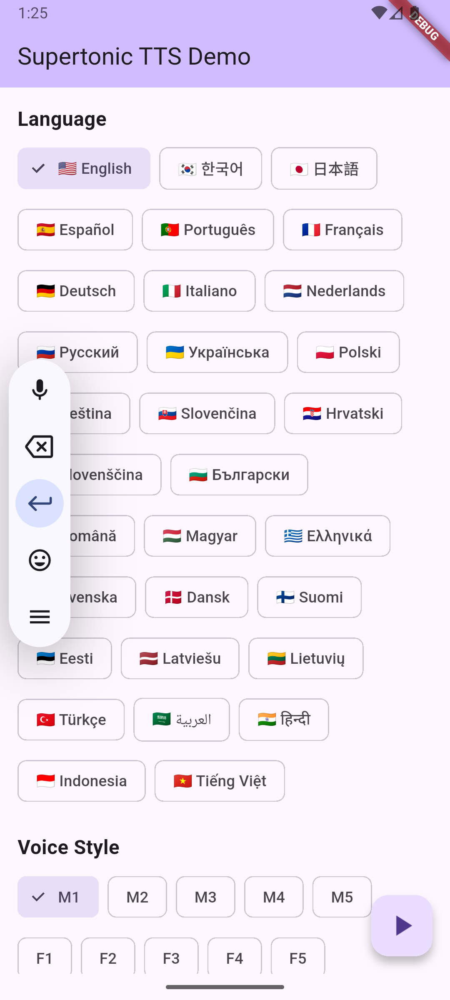

# Supertonic TTS Flutter

Multilingual text-to-speech (TTS) for Flutter. Powered by ONNX Runtime for fast local inference.

> **Note:** This is an unofficial Flutter port of the [Supertonic](https://github.com/supertone-inc/supertonic) project.

> **v2.0.0 — Supertonic 3:** Upgraded to [Supertonic 3](https://huggingface.co/Supertone/supertonic-3) (5 → 31 languages). This is a **breaking** change: the model cache is versioned, so apps re-download the new ~400 MB assets on first run. The old Supertonic 2 cache is left untouched.

## Features

- 🌍 **Multilingual Support** - 31 languages (English, Korean, Japanese, Spanish, Portuguese, French, German, and 24 more), plus a language-agnostic mode (`na`) for unknown-language input
- 😄 **Expression Tags** - Supertonic 3 inline tags such as `<laugh>`, `<breath>`, and `<sigh>` add natural, human-sounding nuance
- 🎭 **Multiple Voice Styles** - 10 voices (5 male, 5 female)
- ⚡ **Local Processing** - Runs fully on-device
- 🎛️ **Customizable** - Adjustable speech speed and quality settings
- 📱 **Cross-Platform** - Supports Android, iOS, macOS, Linux, and Web
- 🔊 **Neural TTS** - Based on diffusion models

## Platform Support

| Platform | Status       | Minimum Version       |
| -------- | ------------ | --------------------- |
| Android  | ✅ Supported | API 21+ (Android 5.0) |
| iOS      | ✅ Supported | iOS 16.0+             |
| macOS    | ✅ Supported | macOS 14.0+           |
| Linux    | ✅ Supported | Ubuntu 20.04+         |
| Web      | ✅ Supported | Modern browsers       |

### Web Setup

For Web builds, `flutter_onnxruntime` requires ONNX Runtime Web to be loaded in
your app's `web/index.html` before `flutter_bootstrap.js`:

```html
<script src="https://cdn.jsdelivr.net/npm/onnxruntime-web@1.22.0/dist/ort.min.js"></script>
<script src="flutter_bootstrap.js" async></script>
```

## Installation

Add this to `pubspec.yaml`:

```yaml
dependencies:
  supertonic_flutter: ^2.1.0
```

## Quick Start

```dart
import 'package:supertonic_flutter/supertonic_flutter.dart';

final tts = SupertonicTTS();
await tts.initialize();

final result = await tts.synthesize(
  'Hello, world!',
  language: 'en',
  voiceStyle: 'M1',
);
```

`initialize()` uses this order:
- cached models
- bundled assets
- download from Hugging Face if needed

### Expression Tags

Add natural, human-sounding nuance with simple inline tags such as `<laugh>`, `<breath>`, and `<sigh>` — they are passed straight through to the model:

```dart
final result = await tts.synthesize(
  'Well <laugh> that was unexpected!',
  language: 'en',
  voiceStyle: 'F2',
);
```

### Language-Agnostic Mode

Not sure which language your text is in? Pass `language: 'na'` and Supertonic handles the input in a language-agnostic way:

```dart
final result = await tts.synthesize(
  'Bonjour and 안녕하세요!',
  language: 'na',
  voiceStyle: 'M1',
);
```

## Model Setup

### Option A: Auto-Download (Recommended)

No manual setup required. Models are downloaded from [Hugging Face](https://huggingface.co/Supertone/supertonic-3) on first use (~400 MB).

```dart
// Just initialize — models download automatically if not found
final tts = SupertonicTTS();
await tts.initialize();
```

To pre-download at a convenient time:

```dart
if (!await SupertonicTTS.modelsReady()) {
  await SupertonicTTS.preDownloadModels(
    onProgress: (done, total, file, progress) {
      print('[$done/$total] $file: ${(progress * 100).toInt()}%');
    },
  );
}
```

### Option B: Bundle Assets Manually

Download the model files from [Hugging Face](https://huggingface.co/Supertone/supertonic-3) and add them to your app's assets. This avoids runtime downloads but increases app size by ~400 MB.

```
assets/
├── onnx/
│   ├── duration_predictor.onnx
│   ├── text_encoder.onnx
│   ├── vector_estimator.onnx
│   ├── vocoder.onnx
│   ├── tts.json
│   └── unicode_indexer.json
└── voice_styles/
    ├── M1.json, M2.json, M3.json, M4.json, M5.json
    └── F1.json, F2.json, F3.json, F4.json, F5.json
```

Update `pubspec.yaml`:

```yaml
flutter:
  assets:
    - assets/onnx/
    - assets/voice_styles/
```

### Platform Configuration

This package uses `flutter_onnxruntime`, which needs a few platform-specific settings:

#### ➡️ Android

Add a ProGuard rule so ONNX Runtime classes are not obfuscated.

Create or edit `android/app/proguard-rules.pro`:

```proguard
-keep class ai.onnxruntime.** { *; }
```

Or run this command from your terminal:

```bash
echo "-keep class ai.onnxruntime.** { *; }" > android/app/proguard-rules.pro
```

See the [flutter_onnxruntime troubleshooting guide](https://github.com/innovation-engineering/flutter_onnxruntime/blob/main/README.md#troubleshooting) for more details.

#### ➡️ iOS

ONNX Runtime requires iOS 16+ and static linkage.

In `ios/Podfile`, update the following lines:

```ruby
platform :ios, '16.0'

# ... existing code ...

target 'Runner' do
  use_frameworks! :linkage => :static

  # ... existing code ...
end
```

And add to the `post_install` hook:

```ruby
post_install do |installer|
  installer.pods_project.targets.each do |target|
    flutter_additional_ios_build_settings(target)
    target.build_configurations.each do |config|
      config.build_settings['IPHONEOS_DEPLOYMENT_TARGET'] = '16.0'
    end
  end
end
```

#### ➡️ macOS

macOS builds require macOS 14+.

In `macos/Podfile`, change:

```ruby
platform :osx, '14.0'
```

Update the "Minimum Deployments" to 14.0 in Xcode:

```bash
open macos/Runner.xcworkspace
```

Then in Xcode:

1. Select **Runner** project in the navigator
2. Select **Runner** target
3. Go to **General** tab
4. Change **Minimum Deployments** to **14.0**

Also add to the `post_install` hook in your Podfile:

```ruby
post_install do |installer|
  installer.pods_project.targets.each do |target|
    flutter_additional_macos_build_settings(target)
    target.build_configurations.each do |config|
      config.build_settings['MACOSX_DEPLOYMENT_TARGET'] = '14.0'
      config.build_settings['ALLOW_STATIC_FRAMEWORK_TRANSITIVE_DEPENDENCIES'] = 'YES'
    end
  end
end
```

## Demo



> See `example/` for a demo app with language selection, voice switching, and adjustable settings.

## More Examples

### Basic Example

```dart
import 'package:supertonic_flutter/supertonic_flutter.dart';

// Initialize
final tts = SupertonicTTS();
await tts.initialize();

// Synthesize speech
final result = await tts.synthesize(
  'Hello, world!',
  language: 'en',
  voiceStyle: 'M1',
);

// Convert to WAV and save
final wavBytes = result.toWavBytes();
final file = File('output.wav');
await file.writeAsBytes(wavBytes);
```

### With Audio Player

```dart
import 'package:supertonic_flutter/supertonic_flutter.dart';

final tts = SupertonicTTS();
final player = TTSAudioPlayer();

// Initialize
await tts.initialize();

// Synthesize and play
final result = await tts.synthesize(
  'Hello, this is a test.',
  language: 'en',
  voiceStyle: 'F1',
  config: TTSConfig(
    speechSpeed: 1.05,
    denoisingSteps: 5,
  ),
);

await player.play(result);
```
